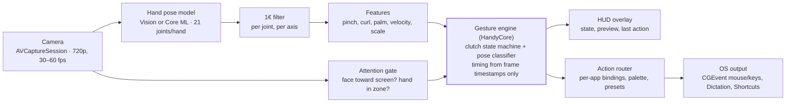
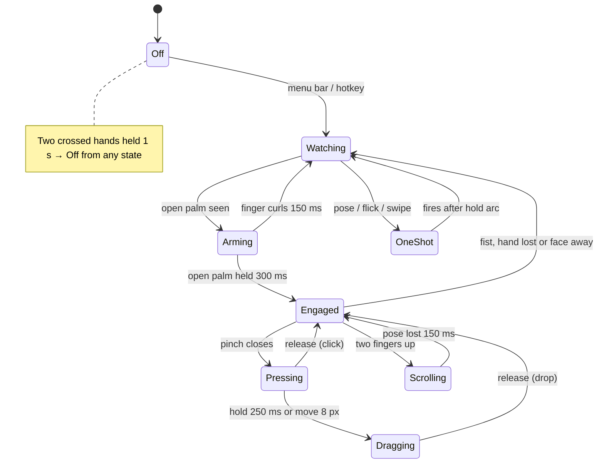

# Technical spec

_Part of the [Handy](../README.md) planning docs · as of Oct 19, 2026_

## Spec — architecture and perception pipeline

**Handy is a Swift menu-bar app with a pure, unit-testable core; each frame goes from camera to OS event in ≤ 80 ms.**

Perception runs left to right on a background queue; only the gesture engine decides whether anything reaches the OS.

### Modules (Swift packages)

| Module | Responsibility | Rule |
| --- | --- | --- |
| HandyCore | Geometry, 1€ filter, features, gesture engine, action model | No AppKit / AVFoundation; deterministic; time only from frame timestamps, so every gesture is replayable in unit tests |
| HandyPerception | Capture, `HandPoseProvider` backends, face/attention | Backends swappable behind one protocol |
| HandyOutput | CGEvent synthesis, Accessibility checks, Dictation, Shortcuts | The only module that touches the OS input stream |
| HandyApp | Menu bar, HUD, onboarding, settings (SwiftUI) | No gesture logic |
| HandyReplay | Record landmark streams (not video) and replay them through HandyCore | Powers the regression suite |
| HandyControl | Local control socket between `handyctl` and the running app | Debug lever only; Unix-domain socket readable by the current user |

### Perception pipeline

1. **Capture.** `AVCaptureSession`, 1280×720 at 30 fps (60 when the camera offers it), `alwaysDiscardsLateVideoFrames = true`, frames mirrored. Throttle to 10 fps when no hand has been seen for 5 s.
2. **Hand pose.** `protocol HandPoseProvider { func process(_ frame: CVPixelBuffer, at t: TimeInterval) -> [HandObservation] }`. Backend A: `VNDetectHumanHandPoseRequest`, `maximumHandCount = 2`. Backend B: MediaPipe hand landmarker converted to Core ML with frame-to-frame ROI tracking (the fasthands approach). The Week 1–3 spike picks the default.
3. **Quality gate.** Drop joints with confidence < 0.3; reject a hand with < 15 valid joints; never infer a click from a low-confidence thumb or index tip.
4. **Identity.** Match hands across frames by nearest wrist; use reported chirality, flipped for the mirrored image.
5. **Filter.** 1€ filter per joint and axis; a separate 1€ filter on the cursor source. Tune with the 2-step procedure (min cutoff first, then beta) and store values per preset; reset all filters on track loss.
6. **Features.** Normalise every distance by hand scale (wrist → middle-finger MCP). Compute pinch distances (thumb tip to index / middle tip), per-finger curl (PIP angle), palm centroid (wrist + four MCPs), palm facing (MCP spread vs scale), and velocities.
7. **Attention gate.** Face rectangle at 5 fps; engagement allowed only while face yaw is within ±30° (configurable for multi-display users).

### Greenfield, not a fork

**Decision (Oct 19, 2026):** Handy is built from scratch on the principles in this spec; we do not fork or bake off Pawvis. Pawvis remains prior art in [research](research.md) (one-euro filter, frame-timestamp engine, index-dip click), but no code is taken from it.

## Spec — gesture engine

**The engine is one explicit state machine; every transition has a hysteresis band and a minimum dwell, so noise cannot flip states.**

One-shot gestures run only while not engaged, so a pointing hand never fires a shortcut. Two crossed hands held 1 s go to Off from any state.

### Detection rules (defaults, all tunable per user)

| Signal | Enter when | Exit when | Notes |
| --- | --- | --- | --- |
| Open palm (arming) | 4 fingers extended, palm facing camera, thumb clear of the index (pinch > 0.6), held 300 ms | any finger curls for 150 ms | Thumb rule keeps an "OK" sign or half-pinch from engaging; progress ring while arming |
| Pinch (press) | thumb–index distance < 0.25 × hand scale | > 0.40 × hand scale | Hysteresis gap prevents flicker; thresholds learned in calibration |
| Click vs drag | release within 250 ms and < 8 px motion | otherwise drag starts | Cursor position frozen from pinch onset |
| Double click | second press within 350 ms, < 12 px away | — | Matches macOS default interval |
| Scroll | index + middle extended, ring + little curled, 150 ms | pose lost for 150 ms | Scroll velocity = palm velocity × gain; momentum decays 0.92 per frame |
| Swipe | palm displacement > 25% of frame width in < 400 ms | — | 600 ms refractory after firing |
| Flick (arrow keys) | clear pointing pose; index tip moves ≥ 0.6 hand scales relative to the wrist within 250 ms, from 150 ms of rest, on a dominant axis | fires after the pose holds 100 ms | Wrist-relative, so moving a pointing hand while talking does not count; 400 ms refractory |
| One-shot pose | classifier confidence > 0.9 for the hold time (default 500 ms) | — | Must exceed "no gesture" class margin by 0.3 |

### Cursor mapping

- **Source:** palm centroid, never a fingertip. It is frozen at pinch onset and during scroll, so clicks land where you aimed.
- **Relative mode (default):** cursor delta = filtered palm delta × gain(v), with a pointer-acceleration curve modelled on macOS trackpad (low gain when slow for precision, high gain when fast to cross the screen). Re-engaging = clutching, like lifting a finger off a trackpad.
- **Absolute mode (P2):** a calibrated interaction box mapped to the active display; box auto-scales with apparent hand size so reach stays constant at 0.5–3 m.
- **Edge snapping:** within 24 px of a screen edge, the cursor sticks for 150 ms so the Dock, menu bar and hot corners are easy to hit.

### Pose classifier

A small MLP (input: 21 joints, normalised to wrist origin, hand scale and in-plane rotation; plus finger-curl angles) outputs the static poses plus a "no gesture" class. Pre-train on HaGRID landmarks, fine-tune on our own recordings, ship as a < 1 MB Core ML model. Custom gestures (P2) use few-shot template matching (DTW over feature sequences) on 5 user takes, as Pawvis does.

### Determinism and tests

The engine takes `(features, timestamp)` and returns `[Event]`; it reads no clock. Every bug report becomes a recorded landmark file and a replay test. CI fails if the false-action count on the regression corpus rises.

## Spec — OS integration, privacy and performance

**Handy needs exactly two permissions (Camera, Accessibility), ships outside the Mac App Store, and keeps every frame in memory only.**

### macOS integration

| Concern | Implementation |
| --- | --- |
| Distribution | Developer ID, notarized, hardened runtime, Sparkle updates. Not App Store: synthesising input for other apps is incompatible with the sandbox |
| Mouse | `CGEvent` mouse moved / down / up / dragged with click-count field set for double and triple clicks; scroll via `CGEvent(scrollWheelEvent2Source:)` in pixel units with momentum phases so apps see trackpad-like scrolling |
| Keyboard | `CGEvent(keyboardEventSource:virtualKey:keyDown:)` with modifier flags; key codes resolved through the current keyboard layout (handles non-US layouts) |
| Zoom / Spaces / Mission Control | Prefer the user's own system shortcuts (read from symbolic hotkeys); fall back to ⌃← / ⌃→ / ⌃↑ |
| Dictation | Send the user's Dictation shortcut; detect if it is unset and guide them in onboarding |
| Custom actions | App launch via `NSWorkspace`, Shortcuts.app via `shortcuts run`, AppleScript only when the user writes one |
| HUD | Borderless `NSPanel`, `.nonactivatingPanel`, ignores mouse events, `sharingType = .none` so it never appears in screen shares |
| Login | `SMAppService.mainApp` launch-at-login, off by default |
| Camera sharing | Coexist with video-call apps; if the camera is taken exclusively, pause and say so in the HUD |

### Permissions flow

1. Camera (`AVCaptureDevice.requestAccess`) — asked when the user clicks "Start tutorial", never at launch.
2. Accessibility (`AXIsProcessTrustedWithOptions`) — asked only when the tutorial reaches the first click; Handy polls and continues automatically once granted.
3. Every permission screen shows a 5-second looping preview of what it enables.

### Privacy

- Frames are processed in memory and dropped; nothing is written to disk.
- Calibration, bindings and custom-gesture templates store landmark numbers only, never images.
- No network access in the default build except the update check; telemetry is opt-in, counts only (e.g. accidental-action reports), and visible in a log the user can open.
- The menu-bar icon shows a distinct state whenever the camera is live (macOS also shows its green indicator).

### Performance budgets (M1, 720p, one hand)

| Stage | Budget |
| --- | --- |
| Capture to buffer available | 33 ms at 30 fps (16 ms at 60 fps) |
| Hand pose inference | ≤ 10 ms |
| Filter + features + engine | ≤ 1 ms |
| Event post to cursor on screen | ≤ 20 ms |
| End-to-end p95 | ≤ 80 ms |
| CPU (one core) | < 15% tracking, < 3% idle-throttled |
| Memory | < 150 MB |

Latency hides by prediction: once measured latency is stable, extrapolate the filtered palm position by half the pipeline delay using its velocity, capped at 20 px.

## Spec — tech stack

**Swift 6 end to end. We borrow [Rat Stack](https://ratstack.sh/)'s principles (typed pieces, a fence, one capability with many surfaces) but not its TypeScript / Effect / Cloudflare tools: Handy has no cloud, and every hot path is an Apple API.**

| Rat Stack principle | Handy implementation |
| --- | --- |
| Pieces: a service interface per job, implementation chosen when provided | A `protocol` per job (`CameraSource`, `HandPoseProvider`, `EventSink`, `Clock`), injected through initializers: live, replay and test values (no DI framework; the ports are few and the core is a pure reducer) |
| Hexagonal ports and adapters | HandyCore holds ports and logic only; Vision, Core ML, AVFoundation and CGEvent live in adapter packages. Enforced by SwiftPM target dependencies, so a wrong import does not compile |
| One contract, many projections | Each `Action` (click, next Space, toggle dictation…) is one typed value with one handler, projected to gesture bindings, menu bar, App Intents (Shortcuts / Spotlight), the `handyctl` CLI and, later, an MCP server |
| XState for stateful work | Gesture engine = pure reducer `(State, Input) -> (State, [Effect])` over exhaustive enums |
| Effect Schema | `Codable & Sendable` value types; versioned settings with decode tests on old fixtures |
| Record / replay devtools | HandyReplay: record landmark streams, replay through the reducer, diff emitted events |
| Cartridges | One SwiftPM package per feature (Palette, Dictation, CustomGestures); deleting one leaves the rest compiling |
| Debt ledger | Every lint suppression is listed in `DEBT.md` with a reason; CI fails if a suppression is not in the ledger |

### Choices

- **Language:** Swift 6 language mode, complete strict concurrency, warnings as errors, typed throws in HandyCore.
- **UI:** SwiftUI for settings and onboarding; AppKit for the HUD panel and menu bar; `@Observable` models (no TCA — the hard logic is already a pure reducer).
- **Perception:** Vision first; Core ML (converted MediaPipe) as a second adapter.
- **Tests:** Swift Testing; replay tests on recorded landmarks; snapshot tests for HUD and settings views.
- **Build:** SwiftPM only, no Xcode project and no Tuist. The app is a SwiftPM executable target (`Handy`); `scripts/package-app.sh` assembles, signs and (with a Developer ID) hardens the `.app` bundle. `make verify` is the single entry point for humans, agents and CI.
- **Ship:** Developer ID + notarization in GitHub Actions on macOS runners; Sparkle updates.

**Rejected:** Electron/Tauri + Effect (camera frames cross a bridge, and native code is still needed for Vision, CGEvent and Accessibility); Rust core + Swift shell (FFI cost on every frame and every test); Python + MediaPipe (prototype grade).

## Spec — agent workflow: verify, fence, skills

**An agent cannot wave its hands at a camera, so the lever is a synthetic hand: every camera input can be replaced by generated or recorded landmarks, and every OS event can be captured instead of posted.** This follows [pstack](https://github.com/backnotprop/pstack)'s core rule: an agent must be able to verify its own work, and repeated manual checks become a tool ("Build the Lever").

### The lever: `handyctl` (debug builds, JSON output, non-zero exit on failure)

| Command | What it proves |
| --- | --- |
| `handyctl doctor` | Build, permissions, camera, model loaded, versions |
| `handyctl synth pinch --hand right --at 0.4,0.5 --hold 300ms --noise 2px -o pinch.lmk` | Generates a parametric landmark clip (pose library + jitter, dropout, lighting-style confidence loss) |
| `handyctl replay pinch.lmk --expect pinch.events.json` | Runs HandyCore headless; diffs emitted events. Deterministic, < 1 s |
| `handyctl inject pinch.lmk --sink record` | Feeds the clip into the running app over the local control socket (a Unix-domain socket, owner-only) instead of the camera; records CGEvents without posting them |
| `handyctl state` | Engine state, HUD state, last N events, filter parameters |
| `handyctl screenshot hud\|settings\|onboarding out.png` | Captures Handy's own windows for visual checks |
| `handyctl bench corpus/` | Latency, jitter (px RMS), false actions per hour vs the stored baseline; fails on regression |
| `handyctl flag palette on` | Toggles feature flags for prototype comparisons |

Build, test and run go through `swift build`, `swift test` and `scripts/run-app.sh`, which give agents compiler and test errors directly; there is no Xcode project to drive.

**Repo skills we write** (in `.agents/skills/`, linked from `AGENTS.md`):

- `verify-handy` — generated with pstack's `/create-verification-skill`, refreshed with `/maintain-verification-skill` as features land.
- `add-a-gesture` — synth clip → failing replay test → engine rule → binding → cheat-sheet entry.
- `add-an-action` — one contract, then every projection (gesture, menu, App Intent, CLI).
- `tune-thresholds` — `handyctl bench` before and after, attach both numbers to the PR.

### The fence: the best practice is the easiest path

| Rule | Enforced by |
| --- | --- |
| HandyCore imports no AppKit, AVFoundation or Vision | SwiftPM target dependencies (compile error) |
| No `Date()`, `DispatchQueue`, `Task.sleep` or `CGEvent` in HandyCore; `CGEvent` only in HandyOutput | SwiftLint custom rules |
| No `try!`, force unwraps, `@unchecked Sendable`, `print` | SwiftLint + Swift 6 strict concurrency |
| Every `Gesture` case has a replay fixture; every `Action` case has an App Intent and CLI projection | Tests that iterate `CaseIterable` and fail on a missing fixture or projection |
| Every lint suppression has a reason | `DEBT.md` ledger checked in CI |
| Formatting and dead code | swift-format, Periphery |
| Nothing lands unverified | lefthook pre-commit: format, lint, fast replay subset; CI: full `make verify` + `handyctl bench` |

### Vetted Swift agent skills to install

The best index is Paul Hudson's [Swift-Agent-Skills](https://github.com/twostraws/Swift-Agent-Skills) (2.9k stars), which accepts only human-written skills under permissive licenses. Read each skill before installing; the index warns that a listing is not an endorsement.

| Skill | Author | Use for |
| --- | --- | --- |
| [pstack / poteto-mode](https://github.com/backnotprop/pstack) (official source: cursor/plugins) | Lauren Tan | Rigor, principles, verification-skill creation |
| [Swift Concurrency Pro](https://github.com/twostraws/Swift-Concurrency-Agent-Skill) | Paul Hudson | Swift 6 strict concurrency, actors, Sendable |
| [Swift Testing Pro](https://github.com/twostraws/Swift-Testing-Agent-Skill) | Paul Hudson | Swift Testing patterns for the replay suite |
| [SwiftUI Pro](https://github.com/twostraws/SwiftUI-Agent-Skill) | Paul Hudson | Settings and onboarding UI |
| [Swift API Design Guidelines](https://github.com/Erikote04/Swift-API-Design-Guidelines-Agent-Skill) | Erik Sebastián de Erice | Naming the ports and actions |
| [App Intents Skill](https://github.com/n0an/App-Intents-Agent-Skill) | Anton Novoselov | The Shortcuts / Spotlight projection |
| [Apple Accessibility Skills](https://github.com/rgmez/apple-accessibility-skills) | Roberto Gómez Muñoz | VoiceOver and Reduce Motion support |
| [SwiftAgents](https://github.com/twostraws/SwiftAgents) (AGENTS.md) | Paul Hudson | Starting point for our `AGENTS.md` |

**Gap:** these skills are mostly iOS/SwiftUI-oriented. Nothing covers Vision hand pose, CGEvent synthesis or Accessibility permissions on macOS, so `handy-vision` and `handy-macos-input` are skills we write ourselves.

## Spec — evaluation, risks, open questions

**Quality is proven on recorded data before every release: a regression corpus for accuracy and false actions, plus a small lab study for feel and fatigue.**

### Evaluation plan

- **Regression corpus:** 20+ people × 4 lighting conditions × 3 distances (0.5, 1.5, 3 m) × skin tones and backgrounds; landmark streams plus labels. Includes 2 h of "no gesture" footage: typing, talking with hands, drinking coffee, video calls.
- **Offline metrics:** per-gesture precision/recall, false actions per hour on the no-gesture set, cursor jitter (px RMS while hand still), lag (ms at 1 m/s).
- **Lab study (n = 12):** ISO 9241-411 pointing task vs trackpad; a scripted 20-minute browsing session; Borg CR10 exertion and Consumed Endurance per session; SUS questionnaire.
- **Beta telemetry (opt-in):** "oops" reports, undo-after-gesture rate, sessions per day, time engaged.

### Risks

| Risk | Likelihood | Impact | Mitigation |
| --- | --- | --- | --- |
| Accidental clicks erode trust | High | High | Clutch + attention gate, hysteresis, "oops" gesture, conservative defaults |
| Thumb–index pinch is occluded from a front camera | Medium | High | A/B against Pawvis's index-dip click in the spike; keep both as options |
| Arm fatigue after 10–20 min | High | Medium | Relative mode at desk height, elbow-rest pointing zone, nudge to rest after 15 min engaged |
| Low light / backlight degrades tracking | Medium | Medium | Framing check, exposure bias, "too dark" message, Continuity Camera option |
| Vision hand pose quality plateau | Medium | Medium | Backend B (MediaPipe on Core ML) behind the same protocol |
| macOS changes event or permission APIs | Low | High | Isolate in HandyOutput; test on each macOS beta |
| Single-maintainer upstream (if forked) | High | Low | Own the fork; upstream fixes where useful |

### Open questions

- [ ] Click gesture: thumb–index pinch (Vision Pro style) or index-finger dip (Pawvis style) as the default?
- [ ] Is Handy a personal tool or a public product? It changes how much we invest in onboarding, telemetry and support.
- [ ] Minimum macOS: 14 (wider reach, `VNDetectHumanHandPoseRequest`) or 15 (Swift-native Vision API)?
- [ ] Should the command palette be gesture-only or also open from a hotkey for mixed keyboard use?
- [ ] Do we want an optional voice layer later, or stay strictly gesture + Dictation?
